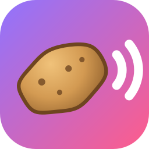
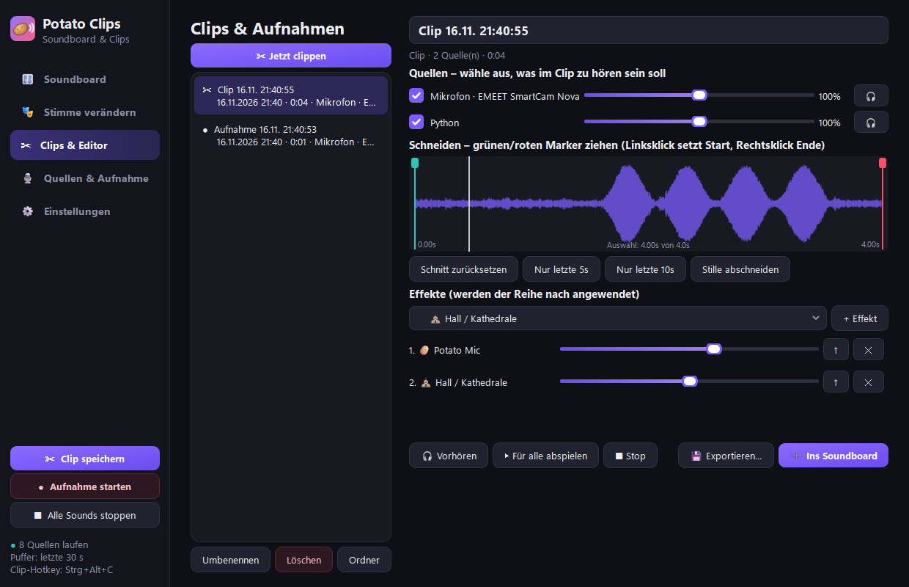

<p align="center">
  
</p>

<h1 align="center">Potato Clips</h1>

<p align="center">
  Soundboard, Clips der letzten 30 Sekunden und Live-Stimmverzerrer für Windows, gebaut für Discord und Gaming.
</p>

<p align="center">
  <a href="../../releases/latest"><b>⬇ Download (Windows-Installer)</b></a>
</p>


## Was kann es?

- **Clips wie bei ShadowPlay, nur für Ton.** Potato Clips nimmt im Hintergrund jede App **einzeln** auf (Discord,
  Spiel, Spotify, Browser, Mikro …). Mit `Strg+Alt+C` speicherst du die **letzten 30 Sekunden**, und zwar
  jede Quelle als eigene Spur. Im Editor wählst du später aus, was zu hören sein soll, zum Beispiel nur Discord
  oder nur das Spiel.
- **Soundboard.** Sounds reinziehen (WAV, MP3, OGG, FLAC), jedem Sound eine Taste geben, abspielen. Du hörst ihn,
  und deine Freunde in Discord hören ihn auch.
- **Stimme live verändern.** 22 Effekte (Potato Mic, Dämon, Roboter, Helium, Funkgerät, Stadion …), jeweils mit
  Stärke-Regler und Hotkeys zum An/Aus, Durchschalten, Stärker und Schwächer.
- **Sauberes Mikro.** KI-Rauschfilter (RNNoise) und Noise-Gate nehmen Tastatur, Lüfter und Klicken raus.
- **Apps an Discord schicken.** Zum Beispiel Spotify, damit deine Freunde die Musik mithören.
- **Aufnahme** einzelner Apps oder von allem, mit Start und Stop per Hotkey.
- **Mini-Overlay** im Spiel: zeigt REC, laufende Sounds und Meldungen und ist klick-durchlässig.
- **Zwei Looks:** *Profi* (dunkel, schlicht) oder *Potato* (gelb, laut, mit Quatsch-Texten). Auf Deutsch oder Englisch.
- **Einrichtungs-Assistent** beim ersten Start: VB-Cable, Discord und Mikro in fünf Schritten.
- **Eigene Effekte mixen:** Tonhöhe, Verzerrung, Hall usw. zu einem eigenen Stimmeffekt kombinieren.
- **Effekt nur beim Drücken:** Taste halten, solange klingt die Stimme verändert.
- **Text vorlesen:** Text eintippen, mit Windows-Stimme (optional mit Effekt) abspielen oder als Sound speichern.
- **Lautstärke-Ducking:** Während ein Sound läuft, werden andere Apps (optional auch Discord) leiser.
- **Clips schnell teilen:** Clip als MP3 in die Zwischenablage kopieren und direkt in Discord einfügen.
- **Sound-Packs:** Sounds als `.potatopack` exportieren und Freunden schicken; Import per Reinziehen.
- **Updates:** Schaut alle paar Stunden auf GitHub nach (auch während die App läuft). Wahlweise *automatisch
  installieren* (erst wenn 10 Minuten lang nichts los ist – kein Call, keine Aufnahme – sonst beim Beenden),
  *immer fragen* oder *aus*. Downloads werden per Prüfsumme kontrolliert.
- **Ordner, Suche & Favoriten:** Sounds in Ordner sortieren, Favoriten nach oben, 🎲 Zufalls-Sound (auch per Hotkey).
- **Alle Sounds gleich laut:** Lautstärke wird automatisch angeglichen; Stille am Anfang wird beim Import
  abgeschnitten. Jeder Sound lässt sich zuschneiden.
- **Handy als Fernbedienung:** QR-Code scannen, dann ist das Dashboard im Handy-Browser (gleiches WLAN, keine App):
  Soundboard, Clip (auch einzelne Apps), Aufnahme mit App-Auswahl, Stimmeffekte und Vorlesen – im Profi- oder
  Potato-Look.
- **Stream Deck & OBS:** Links für Stream Deck (Sounds, Stopp, Clip, Zufall, Stimmeffekt) und ein OBS-Overlay
  als Browser-Quelle.
- **Sprach-Trigger:** Sag ein Wort, und der passende Sound spielt. Die Spracherkennung (Vosk) läuft komplett offline,
  das Sprachpaket (~45 MB) wird beim ersten Einschalten geladen.
- **Sprachbefehle:** „Potato, clip it!“, „Potato, clip Spotify“, „Potato, Aufnahme starten“ / „Aufnahme Discord“ /
  „Aufnahme stoppen“, „Potato, stopp“ – auf Deutsch und Englisch, offline.
- **Ansage nach dem Clip:** Eine Stimme mit Potato-Effekt sagt „Clip by Potato!“ – nur für dich oder auch für Discord;
  Text und Stimme sind einstellbar.
- **Auto-Clip:** Wird es laut (Schreien, Lachen, Jubel), wird automatisch ein Clip gespeichert. Welche Apps das
  auslösen, wählst du selbst: Discord, Spotify, der Voice-Chat im Spiel, dein Mikro …
- **Clip als Video:** MP4 mit animierter Wellenform im Hochformat (TikTok/Shorts/Reels), Quer- oder Quadratformat –
  auf Wunsch mit **Untertiteln** (das gerade gesprochene Wort leuchtet auf).
- **Clips durchsuchen:** Clips offline in Text umwandeln und nach gesagten Wörtern suchen.
- **Maus- & Controller-Tasten:** Seitentasten (Maus 4/5), Mausrad-Klick und Xbox-Controller-Knöpfe (auch Kombis
  wie LB+A) als Hotkey – auch mit Strg/Alt/Shift. Die Maus wird dabei nur „mitgehört“, nie ausgebremst.
- **Sound-Rad:** Taste halten, Maus in eine Richtung ziehen, loslassen – der Sound spielt. Bis zu 8 Sounds
  (Favoriten oder ein Ordner), ideal im Spiel.
- **Effekte pro Sound:** Jedem Sound einen eigenen Effekt geben (Helium-Furz, Dämonen-Lachen …), mit Stärke und
  Vorhören.
- **Potato Wrapped:** Deine Statistik (Top-Sounds, Clips, Lieblings-Stimme …) als Bild zum Teilen – bleibt lokal.
- **Ohrenschutz:** Wird eine App plötzlich viel zu laut (Schreien im Voice-Chat, Earrape-Sounds), wird sie sofort
  leiser und danach langsam wieder normal – auch deine eigenen Sounds auf dem Kopfhörer.
- **Profile pro Spiel:** Startest du ein Spiel, gelten automatisch seine Sound-Hotkeys, sein Sound-Rad und auf Wunsch
  eine andere Stimme.
- **Clips in Discord posten:** Mit einem Discord-Webhook landen Clips und Videos per Klick direkt im Kanal.
- **Voice-Chat-Apps frei wählbar:** Nicht nur Discord – auch Fortnite, WhatsApp, TeamSpeak & Co.
- **Backup & Umzug:** Alle Sounds, Hotkeys und Einstellungen (optional Clips) in eine `.potatobackup`-Datei und auf
  dem neuen PC wieder einspielen. Der alte Stand wird dabei immer aufgehoben.
- **Alles lokal.** Nichts wird hochgeladen, keine Konten und kein Tracking.



## Installieren

1. Neueste **`PotatoClips-Setup-x.y.z.exe`** von der [Releases-Seite](../../releases/latest) laden und starten.
   Es werden keine Administratorrechte gebraucht.
2. Windows zeigt eventuell **„Der Computer wurde durch Windows geschützt“**, weil das Programm nicht signiert ist.
   Dann auf **Weitere Informationen → Trotzdem ausführen** klicken.
3. Damit deine Freunde in Discord deine Sounds und Effekte hören, brauchst du einmalig **[VB-Cable](https://vb-audio.com/Cable/)**
   (kostenlos). Nach der Installation von VB-Cable den PC neu starten.

Potato Clips startet danach im Hintergrund. Das Fenster zu schließen beendet es nicht, es läuft unten rechts im Tray weiter.

## Discord einrichten (einmalig)

1. Potato Clips → **Einstellungen**: Als virtuelles Mikro sollte **CABLE Input** stehen (wird automatisch gefunden).
2. Discord → Einstellungen → **Sprache & Video**:
   - **Eingabegerät: `CABLE Output (VB-Audio Virtual Cable)`**
   - **Rauschunterdrückung: Keine.** Potato Clips filtert schon selbst, und Discords Filter schneidet sonst
     Sounds und Effekte weg.
   - **Echoentfernung: aus**
   - Eingabeempfindlichkeit: nicht automatisch, sondern den Regler weit nach links stellen (oder Push-to-Talk
     benutzen). Sonst schneidet Discord leise Wortanfänge ab.
3. Fertig. In Potato Clips unter **Stimme verändern** muss „An Discord schicken“ an sein.

## Hotkeys (funktionieren auch im Spiel)

| Aktion | Standard |
|---|---|
| Clip speichern (letzte 30 s) | `Strg+Alt+C` |
| Aufnahme starten/stoppen | `Strg+Alt+R` |
| Alle Sounds stoppen | `Strg+Alt+S` |
| Overlay ein/aus | `Strg+Alt+O` |
| Stimmeffekt an/aus | `Strg+Alt+V` |
| Nächster Stimmeffekt | `Strg+Alt+N` |
| Effekt stärker / schwächer | `Strg+Alt+Bild↑` / `Strg+Alt+Bild↓` |

Alles ist unter Einstellungen änderbar. Sound-Hotkeys setzt du im Soundboard per Rechtsklick auf einen Sound.
Mit dem 🖱🎮-Knopf neben einem Hotkey nimmst du stattdessen eine Maus-Seitentaste oder einen Controller-Knopf auf.

## Sprachbefehle

Einstellungen → *Sprach-Trigger* → „Sprachbefehle“ einschalten (das Sprachpaket, ~45 MB, wird einmal geladen).
Dann reicht zum Beispiel:

| Sagen | Passiert |
|---|---|
| „Potato, clip it!“ / „Kartoffel, clip das!“ | die letzten Sekunden clippen |
| „Potato, clip Spotify“ | nur Spotify clippen (jede laufende App geht) |
| „Potato, Aufnahme starten“ / „Potato, Aufnahme Discord“ | alles bzw. nur Discord aufnehmen |
| „Potato, Aufnahme stoppen“ | Aufnahme beenden |
| „Potato, stopp“ | alle Sounds aus |

Auf Englisch: „Potato, clip it“, „Potato, record Discord“, „Potato, stop recording“ …

## Handy, Stream Deck & OBS

- **Handy:** Einstellungen → *Fernbedienung* → „Handy als Fernbedienung“ einschalten und den QR-Code scannen.
  Fragt Windows nach der Firewall, „Private Netzwerke“ erlauben. Der Link enthält einen geheimen Schlüssel;
  mit „Neuer Schlüssel“ werden alte Links ungültig.
- **Stream Deck:** „Stream Deck & OBS“ einschalten, Link kopieren (einzelne Sounds: Rechtsklick auf den Sound →
  „Link für Stream Deck kopieren“), im Stream Deck die Aktion **Website** nehmen und **„Im Hintergrund aufrufen“**
  anhaken.
- **OBS:** Link „OBS-Overlay“ kopieren und als **Browser-Quelle** (600 × 400) einfügen. Zeigt laufende Sounds,
  Stimmeffekt und REC.

## Probleme?

- **Freunde hören nichts:** In Discord muss das Eingabegerät *CABLE Output* sein. In Potato Clips unter *Stimme verändern*
  zeigt der Pegel „Mit Effekt“, ob etwas rausgeht.
- **Hotkeys gehen im Spiel nicht:** Das Spiel läuft als Administrator. Dann Potato Clips auch als Administrator starten.
- **Overlay ist im Spiel nicht zu sehen:** Im Spiel „Randloses Fenster“ statt „Exklusives Vollbild“ einstellen.
- **Wo liegen meine Sounds und Clips?** Unter `%APPDATA%\Potato Clips`. In den Einstellungen gibt es den Knopf „Datenordner öffnen“.

## Für Entwickler

Voraussetzungen: Windows 10/11 (x64), Python 3.12 und Visual Studio 2022 Build Tools (C++).

```bat
git clone https://github.com/swulfen13/potato-clips
cd potato-clips
setup.bat          :: Python-Umgebung + Pakete, baut bin\audiocap.exe
start.bat          :: startet aus dem Quellcode (Daten dann in .\data)
```

Den Installer baust du mit `powershell -File packaging\build.ps1` (braucht `pip install -r requirements-dev.txt`
und [Inno Setup 6](https://jrsoftware.org/isinfo.php)). Das Ergebnis liegt in `dist\PotatoClips-Setup-<version>.exe`.

### Aufbau

```
app.py                  Start, ein einziges Fenster, Tray
soundclip/              Python-App (PySide6-Oberfläche, Clips, Soundboard, Effekte)
  host.py               spricht mit dem Audio-Helfer (ein Prozess für alle Streams)
  capture.py            Quellen finden (Apps mit Ton/Fenster), Ringpuffer pro Quelle, Aufnahme
  mixer.py              Wiedergabe an Kopfhörer und virtuelles Mikro, Stimm-Pfad
  effects.py            32 Effekte und 22 Stimm-Presets (numpy/scipy, streaming-fähig)
  fxworker.py           eigener kleiner Prozess, der live nur den Stimmeffekt rechnet
  inputs.py             Maus-Seitentasten (Raw Input) und Xbox-Controller (XInput) als Hotkeys
  transcribe.py         Clips offline in Text (Vosk) für Suche und Untertitel
  backup.py / stats.py  Backup & Umzug, Statistik für Potato Wrapped
helper/audiocap.cpp     WASAPI-Helfer (C++): Prozess-Loopback pro App, Mikro, Wiedergabe,
                        native Stimme (RNNoise, Gate, Taktausgleich), Effekt-Prozess-Anbindung
packaging/              PyInstaller-Spec, Inno-Setup-Skript, Build-Skript
tools/                  Tests (laufen lautlos über die „Steam Streaming Speakers“ und in eigenem Datenordner)
```

Die Live-Stimme läuft komplett im C++-Helfer: Mikro → Rumpelfilter → RNNoise → Gate → Puffer mit Taktausgleich
→ VB-Cable. Ein Stimmeffekt wird in einem separaten Python-Prozess berechnet, mit dem der Helfer direkt spricht.
Die Oberfläche kann die Stimme deshalb nie zum Stocken bringen.

## Lizenz

MIT, siehe [LICENSE](LICENSE). Verwendete Bibliotheken stehen in [THIRD_PARTY_NOTICES.md](THIRD_PARTY_NOTICES.md).
