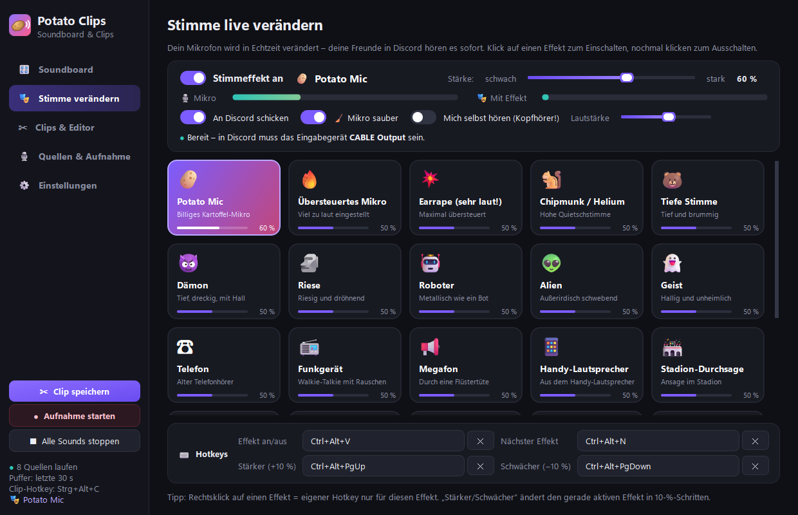

<p align="center">
  
</p>

<h1 align="center">Potato Clips</h1>

<p align="center">
  Soundboard, Clips der letzten 30 Sekunden und Live-Stimmverzerrer für Windows, gebaut für Discord und Gaming.
</p>

<p align="center">
  <a href="../../releases/latest"><b>⬇ Download (Windows-Installer)</b></a>
</p>



## Was kann es?

- **Clips wie bei ShadowPlay, nur für Ton.** Potato Clips nimmt im Hintergrund jede App **einzeln** auf (Discord,
  Spiel, Spotify, Browser, Mikro …). Mit `Strg+Alt+C` speicherst du die **letzten 30 Sekunden**, und zwar
  jede Quelle als eigene Spur. Im Editor wählst du später aus, was zu hören sein soll, zum Beispiel nur Discord
  oder nur das Spiel.
- **Soundboard.** Sounds reinziehen (WAV, MP3, OGG, FLAC), jedem Sound eine Taste geben, abspielen. Du hörst ihn,
  und deine Freunde in Discord hören ihn auch.
- **Stimme live verändern.** 22 Effekte (Potato Mic, Dämon, Roboter, Helium, Funkgerät, Stadion …), jeweils mit
  Stärke-Regler und Hotkeys zum An/Aus, Durchschalten, Stärker und Schwächer.
- **Sauberes Mikro.** KI-Rauschfilter (RNNoise) und Noise-Gate nehmen Tastatur, Lüfter und Klicken raus.
- **Apps an Discord schicken.** Zum Beispiel Spotify, damit deine Freunde die Musik mithören.
- **Aufnahme** einzelner Apps oder von allem, mit Start und Stop per Hotkey.
- **Mini-Overlay** im Spiel: zeigt REC, laufende Sounds und Meldungen und ist klick-durchlässig.
- **Alles lokal.** Nichts wird hochgeladen, keine Konten und kein Tracking.


## Installieren

1. Neueste **`PotatoClips-Setup-x.y.z.exe`** von der [Releases-Seite](../../releases/latest) laden und starten.
   Es werden keine Administratorrechte gebraucht.
2. Windows zeigt eventuell **„Der Computer wurde durch Windows geschützt“**, weil das Programm nicht signiert ist.
   Dann auf **Weitere Informationen → Trotzdem ausführen** klicken.
3. Damit deine Freunde in Discord deine Sounds und Effekte hören, brauchst du einmalig **[VB-Cable](https://vb-audio.com/Cable/)**
   (kostenlos). Nach der Installation von VB-Cable den PC neu starten.

Potato Clips startet danach im Hintergrund. Das Fenster zu schließen beendet es nicht, es läuft unten rechts im Tray weiter.

## Discord einrichten (einmalig)

1. Potato Clips → **Einstellungen**: Als virtuelles Mikro sollte **CABLE Input** stehen (wird automatisch gefunden).
2. Discord → Einstellungen → **Sprache & Video**:
   - **Eingabegerät: `CABLE Output (VB-Audio Virtual Cable)`**
   - **Rauschunterdrückung: Keine.** Potato Clips filtert schon selbst, und Discords Filter schneidet sonst
     Sounds und Effekte weg.
   - **Echoentfernung: aus**
   - Eingabeempfindlichkeit: nicht automatisch, sondern den Regler weit nach links stellen (oder Push-to-Talk
     benutzen). Sonst schneidet Discord leise Wortanfänge ab.
3. Fertig. In Potato Clips unter **Stimme verändern** muss „An Discord schicken“ an sein.

## Hotkeys (funktionieren auch im Spiel)

| Aktion | Standard |
|---|---|
| Clip speichern (letzte 30 s) | `Strg+Alt+C` |
| Aufnahme starten/stoppen | `Strg+Alt+R` |
| Alle Sounds stoppen | `Strg+Alt+S` |
| Overlay ein/aus | `Strg+Alt+O` |
| Stimmeffekt an/aus | `Strg+Alt+V` |
| Nächster Stimmeffekt | `Strg+Alt+N` |
| Effekt stärker / schwächer | `Strg+Alt+Bild↑` / `Strg+Alt+Bild↓` |

Alles ist unter Einstellungen änderbar. Sound-Hotkeys setzt du im Soundboard per Rechtsklick auf einen Sound.

## Probleme?

- **Freunde hören nichts:** In Discord muss das Eingabegerät *CABLE Output* sein. In Potato Clips unter *Stimme verändern*
  zeigt der Pegel „Mit Effekt“, ob etwas rausgeht.
- **Hotkeys gehen im Spiel nicht:** Das Spiel läuft als Administrator. Dann Potato Clips auch als Administrator starten.
- **Overlay ist im Spiel nicht zu sehen:** Im Spiel „Randloses Fenster“ statt „Exklusives Vollbild“ einstellen.
- **Wo liegen meine Sounds und Clips?** Unter `%APPDATA%\Potato Clips`. In den Einstellungen gibt es den Knopf „Datenordner öffnen“.

## Für Entwickler

Voraussetzungen: Windows 10/11 (x64), Python 3.12 und Visual Studio 2022 Build Tools (C++).

```bat
git clone https://github.com/swulfen13/potato-clips
cd potato-clips
setup.bat          :: Python-Umgebung + Pakete, baut bin\audiocap.exe
start.bat          :: startet aus dem Quellcode (Daten dann in .\data)
```

Den Installer baust du mit `powershell -File packaging\build.ps1` (braucht `pip install -r requirements-dev.txt`
und [Inno Setup 6](https://jrsoftware.org/isinfo.php)). Das Ergebnis liegt in `dist\PotatoClips-Setup-<version>.exe`.

### Aufbau

```
app.py                  Start, ein einziges Fenster, Tray
soundclip/              Python-App (PySide6-Oberfläche, Clips, Soundboard, Effekte)
  host.py               spricht mit dem Audio-Helfer (ein Prozess für alle Streams)
  capture.py            Quellen finden (Apps mit Ton/Fenster), Ringpuffer pro Quelle, Aufnahme
  mixer.py              Wiedergabe an Kopfhörer und virtuelles Mikro, Stimm-Pfad
  effects.py            32 Effekte und 22 Stimm-Presets (numpy/scipy, streaming-fähig)
  fxworker.py           eigener kleiner Prozess, der live nur den Stimmeffekt rechnet
helper/audiocap.cpp     WASAPI-Helfer (C++): Prozess-Loopback pro App, Mikro, Wiedergabe,
                        native Stimme (RNNoise, Gate, Taktausgleich), Effekt-Prozess-Anbindung
packaging/              PyInstaller-Spec, Inno-Setup-Skript, Build-Skript
tools/                  Tests (laufen lautlos über die „Steam Streaming Speakers“ und in eigenem Datenordner)
```

Die Live-Stimme läuft komplett im C++-Helfer: Mikro → Rumpelfilter → RNNoise → Gate → Puffer mit Taktausgleich
→ VB-Cable. Ein Stimmeffekt wird in einem separaten Python-Prozess berechnet, mit dem der Helfer direkt spricht.
Die Oberfläche kann die Stimme deshalb nie zum Stocken bringen.

## Lizenz

MIT, siehe [LICENSE](LICENSE). Verwendete Bibliotheken stehen in [THIRD_PARTY_NOTICES.md](THIRD_PARTY_NOTICES.md).
